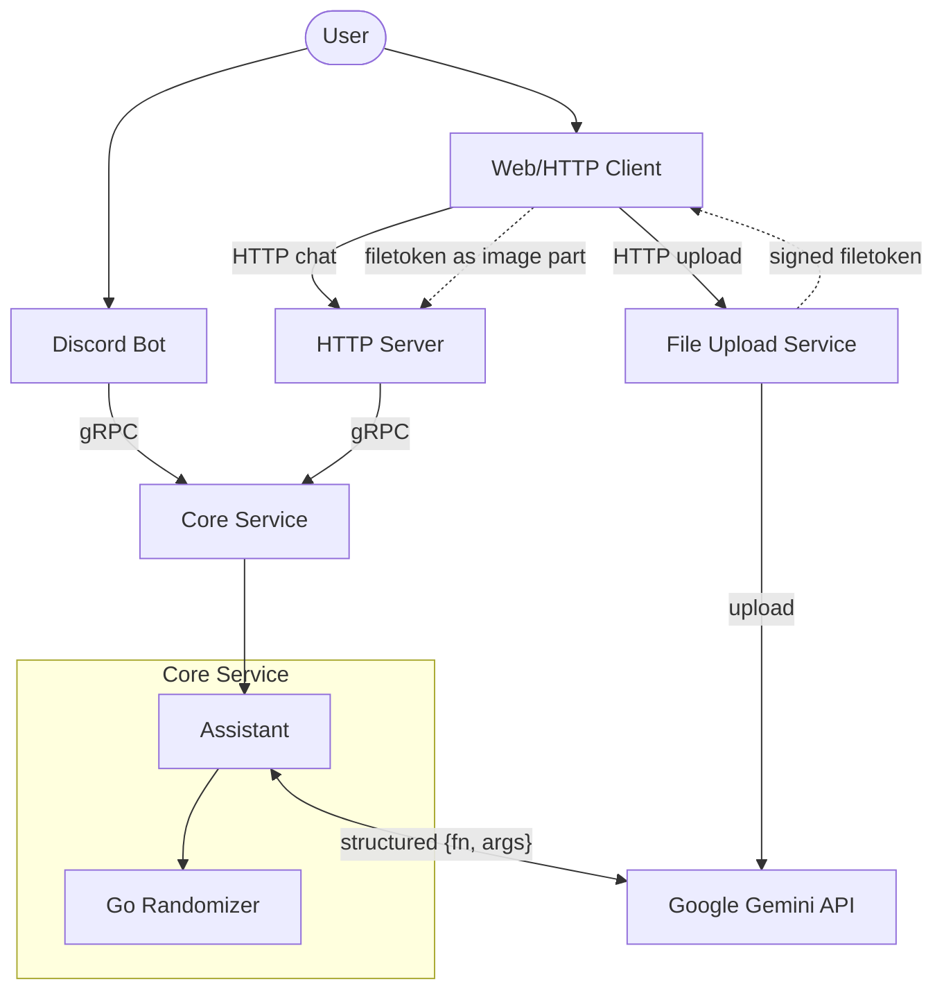

English | [繁體中文](./README.zh-TW.md)
# Magic Conch Shell

[](https://go.dev/)
[](LICENSE)

Magic Conch Shell is a chatbot inspired by the "Magic Conch Shell" from SpongeBob SquarePants. Ask it anything and it gives you a straight, decisive answer.

## What It Can Do

- **Make decisions for you**: "Ramen or burger?", "Should I go out tonight?", "Pick 3 lucky numbers" — the shell picks for you.
- **Look at pictures**: Send photos of two outfits and ask which one to buy.
- **Chat on Discord**: Mention the bot or use `/q`, and reply to its messages to keep the conversation going.
- **Speak English and Chinese**.
- **Plug into websites and apps** through its HTTP API.

## Quick Start

The **integrated** build runs Core and the Discord bot in one process.

### Prerequisites

- Go 1.27 or higher
- Google AI (Gemini) API Key
- Discord Bot Token

### Run

Every service reads its configuration from environment variables:

```bash
cd integrated/discord
export LLM_API_KEY=your_gemini_api_key
export MODEL_NAME=gemini-2.5-flash-lite
export ALLOWED_IMAGE_DOMAINS=cdn.discordapp.com,media.discordapp.net
export DISCORD_TOKEN=your_discord_bot_token
go run ./cmd
```

For the distributed deployment (Core, Discord, HTTP Server, and File Upload as separate processes), see [Services](#services). For a Docker Compose stack with a TLS gateway and OAuth2/JWT auth, see [`examples/README.md`](examples/README.md).

## System Architecture



File Upload uploads an image to the Gemini Files API and returns a filetoken signed with `FILE_TOKEN_KEY`. The client sends that token as the `content` of an image part, and Core verifies it with `FILE_TOKEN_KEYS` to get the Gemini file URI. See [`examples/README.md`](examples/README.md) for a full deployment.

## Directory Structure

- `/core`: Assistant (Gemini client, randomizer, image cache) and gRPC server.
- `/discord`: Discord bot frontend.
- `/httpserver`: HTTP API in front of Core.
- `/fileupload`: HTTP service that uploads images and issues filetokens.
- `/filetoken`: Library for signing and verifying filetokens.
- `/grpcclient`: gRPC client for Core.
- `/integrated`: Core and a frontend in a single process.
- `/examples`: Full Docker Compose deployment (gateway, OAuth2/JWT auth, all services) with its own [README](examples/README.md) and [OpenAPI spec](examples/openapi.yml).

## Services

Each service is its own Go module and its own process. Run each one from its module directory with `go run ./cmd`.

### Core — `core/cmd`

The gRPC engine with an optional interactive console. On startup it lists the models available to `LLM_API_KEY` and exits with status 1 if `MODEL_NAME` is missing from that list.

| Env var | Required | Default | Purpose |
|---|---|---|---|
| `LLM_API_KEY` | Yes | — | Gemini API key. |
| `MODEL_NAME` | Yes | — | Gemini model name (e.g. `gemini-2.5-flash-lite`). |
| `GRPC_ADDRESS` | No | — | Set to start the gRPC server. TCP or `unix://...`. |
| `FILE_TOKEN_KEYS` | No | — | Comma-separated `<id>:<base64url secret>` keys to verify filetokens from File Upload. |
| `ALLOWED_IMAGE_DOMAINS` | No | — | Comma-separated hostnames accepted for `http(s)` image URLs. |
| `IMAGE_CACHE_PATH` | No | `image_cache` | BadgerDB directory for image URL uploads, or a `redis://...` URL. |
| `CONSOLE_MODE` | No | — | `true` runs an interactive console alongside the gRPC server. |
| `GRPC_TLS_CERT` / `GRPC_TLS_KEY` | No | — | Set both to serve gRPC over TLS. |
| `GRPC_TLS_CA` | No | — | Set to require client certificates (mTLS). |
| `GRPC_MAX_RECV_MSG_SIZE` / `GRPC_MAX_SEND_MSG_SIZE` | No | 4 MiB each | Max gRPC message size. |
| `GRPC_KEEPALIVE_TIME` / `GRPC_KEEPALIVE_TIMEOUT` | No | `2h` / `20s` | gRPC keepalive parameters. |
| `LANG` | No | `en` | Console-mode system-instruction language. |

```bash
cd core
go run ./cmd
```

Check the gRPC server with [`grpc_health_probe`](https://github.com/grpc-ecosystem/grpc-health-probe) (bundled at `/app/grpc_health_probe` in the Core image):

```bash
grpc_health_probe -addr=localhost:50051
```

### Discord — `discord/cmd`

Discord bot frontend that calls Core over gRPC.

| Env var | Required | Default | Purpose |
|---|---|---|---|
| `DISCORD_TOKEN` | Yes | — | Discord bot token. |
| `GRPC_ADDRESS` | Yes | — | Core's gRPC address. |
| `GRPC_TLS_CA` | No | — | CA cert to verify Core's TLS cert. |
| `GRPC_TLS_CERT` / `GRPC_TLS_KEY` | No | — | Client cert/key for mTLS to Core. |
| `GRPC_TLS_SERVER_NAME` | No | — | Server name to verify in Core's TLS cert. |
| `LANG` | No | `en` | Response language for mention and channel messages. |

```bash
cd discord
go run ./cmd
```

### HTTP Server — `httpserver/cmd`

JSON chat endpoint in front of Core.

| Env var | Required | Default | Purpose |
|---|---|---|---|
| `HTTP_ADDRESS` | Yes | — | Listen address, TCP or `unix://...`. |
| `GRPC_ADDRESS` | Yes | — | Core's gRPC address. |
| `CORS_ALLOWED_ORIGINS` | No | — | Comma-separated allow-list (`*` allows any origin). |
| `GRPC_TLS_CA` | No | — | CA cert to verify Core's TLS cert. |
| `GRPC_TLS_CERT` / `GRPC_TLS_KEY` | No | — | Client cert/key for mTLS to Core. |
| `GRPC_TLS_SERVER_NAME` | No | — | Server name to verify in Core's TLS cert. |

```bash
cd httpserver
go run ./cmd
```

Send a chat request:

```bash
curl -X POST http://localhost:8080/ -H "Content-Type: application/json" -d '{
  "language": "LANGUAGE_EN",
  "current_message": { "parts": [{ "type": "text", "content": "Pizza or sushi?" }] }
}'
```

`language` takes `LANGUAGE_EN` or `LANGUAGE_ZH`. Error responses use `400`, `429`, `503`, `504`, or `500` according to Core's gRPC status; see [`examples/openapi.yml`](examples/openapi.yml).

### File Upload — `fileupload/cmd`

Uploads images to Gemini and returns a filetoken to use as an image part's `content`.

| Env var | Required | Default | Purpose |
|---|---|---|---|
| `HTTP_ADDRESS` | Yes | — | Listen address, TCP or `unix://...`. |
| `GEMINI_API_KEY` | Yes | — | Gemini API key from the same Gemini project as Core's `LLM_API_KEY`. |
| `FILE_TOKEN_KEY` | Yes | — | `<id>:<base64url secret>` signing key; list the same key in Core's `FILE_TOKEN_KEYS`. |
| `REDIS_URL` | No | — | Redis URL to reuse issued filetokens for identical uploads. |
| `CORS_ALLOWED_ORIGINS` | No | — | Same as HTTP Server. |

```bash
cd fileupload
go run ./cmd
```

### Integrated Discord — `integrated/discord/cmd`

Core and the Discord bot in a single process. Used by [Quick Start](#quick-start).

| Env var | Required | Default | Purpose |
|---|---|---|---|
| `LLM_API_KEY` | Yes | — | Gemini API key. |
| `MODEL_NAME` | Yes | — | Gemini model name. |
| `DISCORD_TOKEN` | Yes | — | Discord bot token. |
| `ALLOWED_IMAGE_DOMAINS` | No | — | Same as Core; set to `cdn.discordapp.com,media.discordapp.net` for Discord attachments. |
| `IMAGE_CACHE_PATH` | No | `image_cache` | Same as Core. |
| `FILE_TOKEN_KEYS` | No | — | Same as Core. |
| `LANG` | No | `en` | Response language for mention and channel messages. |

```bash
cd integrated/discord
go run ./cmd
```

## Filetoken Keys

Generate a signing key:

```bash
echo "k1:$(openssl rand -base64 32 | tr '+/' '-_' | tr -d '=')"
```

Set it as File Upload's `FILE_TOKEN_KEY` and include it in Core's `FILE_TOKEN_KEYS`.

To rotate keys:

1. Add the new key to Core: `FILE_TOKEN_KEYS=k2:<new>,k1:<old>`.
2. Switch File Upload to `FILE_TOKEN_KEY=k2:<new>`.
3. After 47 hours, remove `k1` from Core's `FILE_TOKEN_KEYS`.

## Usage

### Discord
- **Mention the Bot**: "@MagicConch Should I have ramen or a burger today?"
- **Reply to Conversations**: Reply to a message to include its reply chain as context.
- **Image Input**: Send an image and ask "Which outfit should I buy?".
- **Slash Commands**:
  - `/q`: Ask the shell a question (answers in the user's Discord locale).
  - `/set-channel`: Set the response channel (Administrators only).

### Console Mode (Core)
Set `CONSOLE_MODE=true` and type questions into the terminal.

## Development and Customization

### Custom Decision Logic
Add or modify handlers in `core/assistant/randomizer`; the `fn` enum in the response schema follows the registered handlers. Adjust `core/assistant/systemInstruction` to guide how Gemini chooses functions and arguments.

### gRPC Contract
Edit `core/structs/structs.proto`, then run from `core/`:

```bash
go run github.com/bufbuild/buf/cmd/buf@v1.75.0 lint
go run github.com/bufbuild/buf/cmd/buf@v1.75.0 breaking --against '../.git#branch=main,subdir=core'
go run github.com/bufbuild/buf/cmd/buf@v1.75.0 generate
```

### Tests
Run `go test ./...` in each module directory.
