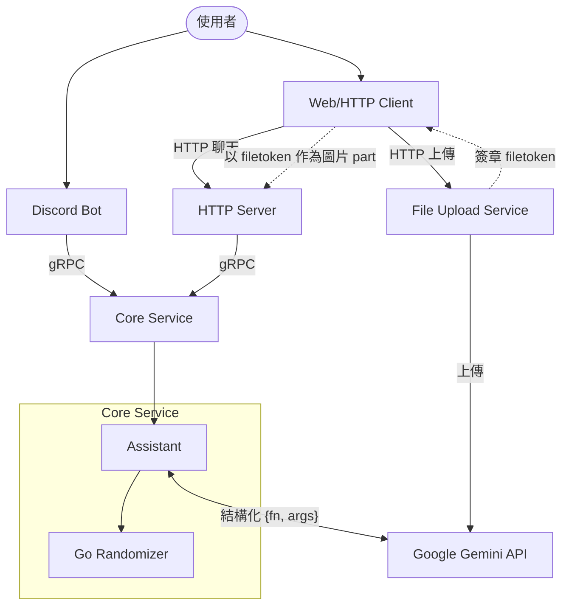

[English](README.md) | 繁體中文
# Magic Conch Shell (神奇海螺)

[](https://go.dev/)
[](LICENSE)

神奇海螺是一個靈感來自《海綿寶寶》的聊天機器人。不管問什麼，它都會毫不猶豫地直接給你答案。

## 它能做什麼

- **幫你做決定**：「吃拉麵還是漢堡？」「今晚要不要出門？」「挑 3 個幸運數字」——海螺直接替你選。
- **看圖回答**：傳兩件衣服的照片，問它該買哪一件。
- **在 Discord 上聊天**：標記機器人或使用 `/q` 提問，回覆它的訊息就能接著問。
- **支援中文與英文**。
- **可以接到網站或其他應用**：透過 HTTP API 串接。

## 快速開始

**單體式 (integrated)** 版本在同一個行程中執行 Core 與 Discord bot。

### 前置要求

- Go 1.27 或以上版本
- Google AI (Gemini) API Key
- Discord Bot Token

### 執行

所有服務都從環境變數讀取設定：

```bash
cd integrated/discord
export LLM_API_KEY=your_gemini_api_key
export MODEL_NAME=gemini-2.5-flash-lite
export ALLOWED_IMAGE_DOMAINS=cdn.discordapp.com,media.discordapp.net
export DISCORD_TOKEN=your_discord_bot_token
go run ./cmd
```

分散式部署（Core、Discord、HTTP Server、File Upload 各自獨立執行）請參考 [服務說明](#服務說明)。包含 TLS gateway 與 OAuth2/JWT 認證的 Docker Compose 堆疊請參考 [`examples/README.zh-TW.md`](examples/README.zh-TW.md)。

## 系統架構



File Upload 把圖片上傳到 Gemini Files API，回傳以 `FILE_TOKEN_KEY` 簽章的 filetoken。Client 把這個 token 放進圖片 part 的 `content` 送出，Core 再用 `FILE_TOKEN_KEYS` 驗證並取得 Gemini file URI。完整部署請參考 [`examples/README.zh-TW.md`](examples/README.zh-TW.md)。

## 目錄說明

- `/core`: Assistant（Gemini client、randomizer、圖片快取）與 gRPC server。
- `/discord`: Discord bot 前端。
- `/httpserver`: 位於 Core 前方的 HTTP API。
- `/fileupload`: 上傳圖片並發出 filetoken 的 HTTP 服務。
- `/filetoken`: 簽發與驗證 filetoken 的 library。
- `/grpcclient`: 連線 Core 的 gRPC client。
- `/integrated`: 將 Core 與前端整合在同一個行程的版本。
- `/examples`: 完整的 Docker Compose 部署範例（gateway、OAuth2/JWT 認證、所有服務），內含自己的 [README](examples/README.zh-TW.md) 與 [OpenAPI 規格](examples/openapi.yml)。

## 服務說明

每個服務都是獨立的 Go module、獨立的行程。在各自的 module 目錄下以 `go run ./cmd` 執行。

### Core — `core/cmd`

gRPC 引擎，可選擇同時開啟互動式終端機。啟動時會列出 `LLM_API_KEY` 可用的模型，`MODEL_NAME` 不在其中就以 exit code 1 結束。

| 環境變數 | 是否必填 | 預設值 | 用途 |
|---|---|---|---|
| `LLM_API_KEY` | 是 | — | Gemini API key。 |
| `MODEL_NAME` | 是 | — | Gemini 模型名稱（如 `gemini-2.5-flash-lite`）。 |
| `GRPC_ADDRESS` | 否 | — | 設定後啟動 gRPC server，可為 TCP 或 `unix://...`。 |
| `FILE_TOKEN_KEYS` | 否 | — | 以逗號分隔的 `<id>:<base64url secret>`，用來驗證 File Upload 發出的 filetoken。 |
| `ALLOWED_IMAGE_DOMAINS` | 否 | — | 允許作為 `http(s)` 圖片網址的主機名稱，以逗號分隔。 |
| `IMAGE_CACHE_PATH` | 否 | `image_cache` | 圖片網址上傳快取的 BadgerDB 目錄，或 `redis://...` URL。 |
| `CONSOLE_MODE` | 否 | — | 設為 `true` 會在 gRPC server 旁同時執行互動式終端機。 |
| `GRPC_TLS_CERT` / `GRPC_TLS_KEY` | 否 | — | 兩者同時設定即以 TLS 提供 gRPC。 |
| `GRPC_TLS_CA` | 否 | — | 設定後要求 client 憑證（mTLS）。 |
| `GRPC_MAX_RECV_MSG_SIZE` / `GRPC_MAX_SEND_MSG_SIZE` | 否 | 各 4 MiB | gRPC 訊息大小上限。 |
| `GRPC_KEEPALIVE_TIME` / `GRPC_KEEPALIVE_TIMEOUT` | 否 | `2h` / `20s` | gRPC keepalive 參數。 |
| `LANG` | 否 | `en` | 終端機模式的 system instruction 語言。 |

```bash
cd core
go run ./cmd
```

以 [`grpc_health_probe`](https://github.com/grpc-ecosystem/grpc-health-probe) 檢查 gRPC server（Core image 內附於 `/app/grpc_health_probe`）：

```bash
grpc_health_probe -addr=localhost:50051
```

### Discord — `discord/cmd`

透過 gRPC 呼叫 Core 的 Discord bot 前端。

| 環境變數 | 是否必填 | 預設值 | 用途 |
|---|---|---|---|
| `DISCORD_TOKEN` | 是 | — | Discord Bot Token。 |
| `GRPC_ADDRESS` | 是 | — | Core 的 gRPC 位址。 |
| `GRPC_TLS_CA` | 否 | — | 驗證 Core TLS 憑證用的 CA 憑證。 |
| `GRPC_TLS_CERT` / `GRPC_TLS_KEY` | 否 | — | 與 Core 進行 mTLS 的 client 憑證/金鑰。 |
| `GRPC_TLS_SERVER_NAME` | 否 | — | 驗證 Core TLS 憑證時使用的 server name。 |
| `LANG` | 否 | `en` | 標記與頻道訊息的回應語言。 |

```bash
cd discord
go run ./cmd
```

### HTTP Server — `httpserver/cmd`

位於 Core 前方的 JSON 聊天 endpoint。

| 環境變數 | 是否必填 | 預設值 | 用途 |
|---|---|---|---|
| `HTTP_ADDRESS` | 是 | — | 監聽位址，可為 TCP 或 `unix://...`。 |
| `GRPC_ADDRESS` | 是 | — | Core 的 gRPC 位址。 |
| `CORS_ALLOWED_ORIGINS` | 否 | — | 允許的來源清單，以逗號分隔（`*` 代表允許任何來源）。 |
| `GRPC_TLS_CA` | 否 | — | 驗證 Core TLS 憑證用的 CA 憑證。 |
| `GRPC_TLS_CERT` / `GRPC_TLS_KEY` | 否 | — | 與 Core 進行 mTLS 的 client 憑證/金鑰。 |
| `GRPC_TLS_SERVER_NAME` | 否 | — | 驗證 Core TLS 憑證時使用的 server name。 |

```bash
cd httpserver
go run ./cmd
```

送出聊天請求：

```bash
curl -X POST http://localhost:8080/ -H "Content-Type: application/json" -d '{
  "language": "LANGUAGE_ZH",
  "current_message": { "parts": [{ "type": "text", "content": "今晚吃拉麵還是咖哩？" }] }
}'
```

`language` 填 `LANGUAGE_EN` 或 `LANGUAGE_ZH`。錯誤回應依 Core 的 gRPC status 使用 `400`、`429`、`503`、`504` 或 `500`，詳見 [`examples/openapi.yml`](examples/openapi.yml)。

### File Upload — `fileupload/cmd`

把圖片上傳到 Gemini，回傳可作為圖片 part `content` 的 filetoken。

| 環境變數 | 是否必填 | 預設值 | 用途 |
|---|---|---|---|
| `HTTP_ADDRESS` | 是 | — | 監聽位址，可為 TCP 或 `unix://...`。 |
| `GEMINI_API_KEY` | 是 | — | 與 Core 的 `LLM_API_KEY` 屬於同一個 Gemini project 的 API key。 |
| `FILE_TOKEN_KEY` | 是 | — | `<id>:<base64url secret>` 簽章金鑰；同一把 key 要列在 Core 的 `FILE_TOKEN_KEYS`。 |
| `REDIS_URL` | 否 | — | 相同檔案重複上傳時沿用已發出 filetoken 的 Redis URL。 |
| `CORS_ALLOWED_ORIGINS` | 否 | — | 與 HTTP Server 相同。 |

```bash
cd fileupload
go run ./cmd
```

### 單體式 Discord — `integrated/discord/cmd`

在單一行程中執行 Core 與 Discord bot，即[快速開始](#快速開始)使用的版本。

| 環境變數 | 是否必填 | 預設值 | 用途 |
|---|---|---|---|
| `LLM_API_KEY` | 是 | — | Gemini API key。 |
| `MODEL_NAME` | 是 | — | Gemini 模型名稱。 |
| `DISCORD_TOKEN` | 是 | — | Discord Bot Token。 |
| `ALLOWED_IMAGE_DOMAINS` | 否 | — | 同 Core；Discord 附件請設為 `cdn.discordapp.com,media.discordapp.net`。 |
| `IMAGE_CACHE_PATH` | 否 | `image_cache` | 同 Core。 |
| `FILE_TOKEN_KEYS` | 否 | — | 同 Core。 |
| `LANG` | 否 | `en` | 標記與頻道訊息的回應語言。 |

```bash
cd integrated/discord
go run ./cmd
```

## Filetoken 金鑰

產生簽章金鑰：

```bash
echo "k1:$(openssl rand -base64 32 | tr '+/' '-_' | tr -d '=')"
```

設為 File Upload 的 `FILE_TOKEN_KEY`，並加入 Core 的 `FILE_TOKEN_KEYS`。

輪替金鑰：

1. 在 Core 加入新 key：`FILE_TOKEN_KEYS=k2:<new>,k1:<old>`。
2. 將 File Upload 改為 `FILE_TOKEN_KEY=k2:<new>`。
3. 47 小時後，從 Core 的 `FILE_TOKEN_KEYS` 移除 `k1`。

## 使用方法

### Discord
- **直接標記機器人**：@神奇海螺 我今天該吃拉麵還是漢堡？
- **回覆對話**：回覆訊息時，整條回覆鏈會作為上下文。
- **圖片輸入**：傳送圖片並問「我該買哪件衣服？」。
- **斜線指令**：
  - `/q`: 向海螺提問（依使用者的 Discord 語系回答）。
  - `/set-channel`: 設定回應頻道（僅限管理員）。

### 終端機模式 (Core Console)
設定 `CONSOLE_MODE=true` 後，直接在終端機輸入問題。

## 開發與自定義

### 自定義決策邏輯
在 `core/assistant/randomizer` 新增或修改 handler；response schema 的 `fn` enum 會跟著已註冊的 handler。修改 `core/assistant/systemInstruction` 來引導 Gemini 選擇函式與參數。

### gRPC 合約
修改 `core/structs/structs.proto` 後，在 `core/` 執行：

```bash
go run github.com/bufbuild/buf/cmd/buf@v1.75.0 lint
go run github.com/bufbuild/buf/cmd/buf@v1.75.0 breaking --against '../.git#branch=main,subdir=core'
go run github.com/bufbuild/buf/cmd/buf@v1.75.0 generate
```

### 測試
在各 module 目錄執行 `go test ./...`。
